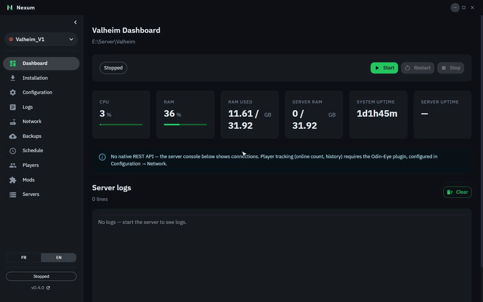
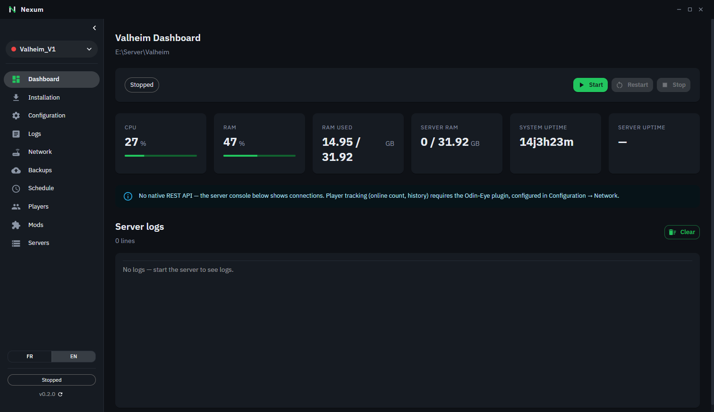
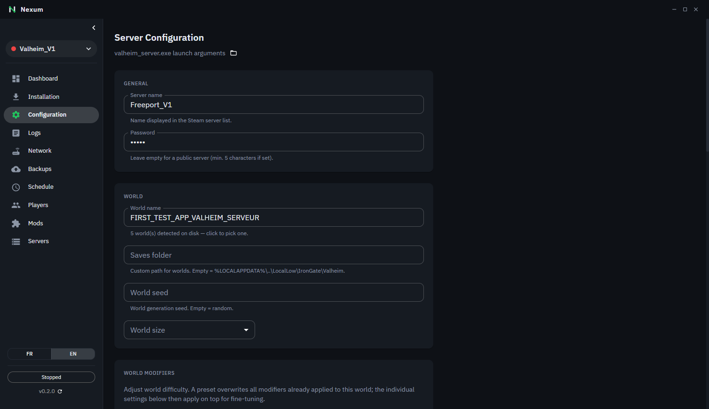
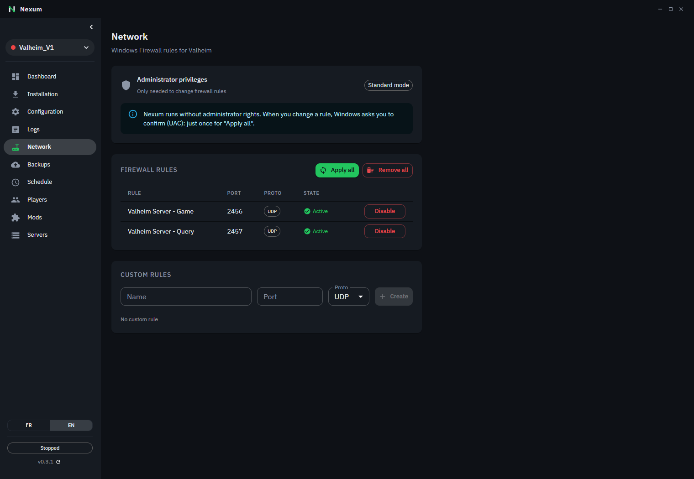
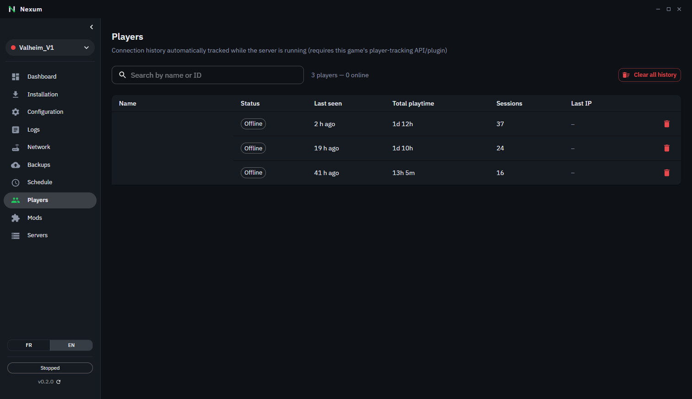

<h1 align="center">
  <picture>
    <source media="(prefers-color-scheme: dark)" srcset="docs/images/nexum-logo-dark-bg-1200.png">
    
  </picture>
</h1>

🇬🇧 English | 🇫🇷 [Français](README.fr.md)

Free, open-source Windows app to run **Valheim**, **Palworld**, **Astroneer** and **RuneScape: Dragonwilds** dedicated servers without the command line, with built-in **Valheim mod management** (Thunderstore + Hexium).


[](https://discord.gg/DbJ3WkK5QU)

<p align="center">
  
</p>

## Features

- **Multiple servers, multiple games**: Palworld, Valheim, Astroneer and RuneScape: Dragonwilds from one app, no command line, with port conflicts detected before startup
- **Automatic install** of SteamCMD and the game server, or **import a server that is already installed** (game and worlds detected automatically)
- **Start / stop / restart** with clean shutdown (Palworld REST API, Valheim CTRL+C) so saves don't get corrupted, and automatic restart after a crash
- **Real-time monitoring**: CPU, RAM, uptime, online players, server console
- **Visual configuration editor** for each game (Palworld difficulty presets, Valheim world modifiers)
- **Valheim mods**: browse, install and update from **Thunderstore and Hexium**, automatic dependencies, r2modman/Gale profile import, BepInEx config editor, deprecated mods flagged
- **Player tracking**: history, playtime, sessions (native on Palworld, Valheim via Odin-Eye); kick / ban / unban on Palworld
- **Windows firewall**: rules created automatically + custom rules
- **Scheduled automatic backups** with rotation
- **Daily scheduled restart** with in-game announcement and save
- **Built-in app updates**
- **Bilingual UI**: English / French

## Screenshots

<table>
  <tr>
    <td><br/><sub>Dashboard</sub></td>
    <td><br/><sub>Mods (Thunderstore & Hexium)</sub></td>
  </tr>
  <tr>
    <td><br/><sub>Server configuration</sub></td>
    <td><br/><sub>Firewall rules</sub></td>
  </tr>
  <tr>
    <td><br/><sub>Player history</sub></td>
    <td></td>
  </tr>
</table>

## Installation

Download the latest version from [Releases](https://github.com/THEREALM00D/nexum/releases):

- **Installer**: `nexum-{version}-setup.exe`
- **Portable**: `nexum-{version}-portable.exe`

> **No administrator rights needed.** Nexum runs as a normal app. Only changing Windows Firewall rules needs them: Windows then asks you to confirm (UAC), once per change.

**Windows SmartScreen warning**: the installer is not code-signed yet, so Windows may show "Windows protected your PC" on first launch. Click **More info → Run anyway**. The source code is open (GPL-3.0), and each release lists the **SHA256** of its files so you can check your download:

```powershell
Get-FileHash .\nexum-<version>-setup.exe -Algorithm SHA256
```

## Quick start

1. Launch **Nexum**: on first launch, the **setup wizard** opens
2. Pick your game, then **Install a new server** or **I already have a server**
3. Follow the steps: installation (SteamCMD + server), configuration, firewall
4. Click **Start**, then share the address shown under **Join the server** with your friends

You can run the wizard again for another server from **Servers → Setup wizard**.

See [docs/installation.md](docs/installation.md) for the full guide.

## Documentation

- [Installation](docs/installation.md)
- [Dashboard](docs/dashboard.md)
- [Server configuration](docs/configuration.md)
- [Network & firewall](docs/network.md)
- [Backups](docs/backups.md)
- [Scheduling](docs/scheduling.md)
- [Logs](docs/logs.md)
- [Valheim player tracking (Odin-Eye)](docs/valheim-players.md)
- [Valheim mods](docs/valheim-mods.md)
- [RuneScape: Dragonwilds](docs/dragonwilds.md)
- [Code signing policy and privacy](docs/code-signing.md)
- [Technical architecture](CLAUDE.md)

## Help & community

- **Questions, help, ideas**: join the [Nexum Discord](https://discord.gg/DbJ3WkK5QU) (there is a channel for French speakers too). From the app, use the **Help & Discord** button at the bottom of the sidebar.
- **Bugs**: open an [issue on GitHub](https://github.com/THEREALM00D/nexum/issues/new/choose).

## Tech stack

- Electron 44, React 19, MUI 9, TypeScript 6, Vite 5

## License

Open source under the [GNU General Public License v3.0 or later](LICENSE). You are free to use, study, modify and share the software; any modified version you distribute must stay open source under the same license.

## Contributing

The `main` branch is protected: all contributions go through a Pull Request, and only the project maintainer can merge it.

PR titles must follow [Conventional Commits](https://www.conventionalcommits.org/) (`feat: …`, `fix: …`, `chore: …`), which is checked in CI. Versions and the [CHANGELOG](CHANGELOG.md) are generated from these titles by [release-please](https://github.com/googleapis/release-please-action): `fix` bumps the patch version, `feat` bumps the minor version, and releases are published by merging the release PR it opens.
