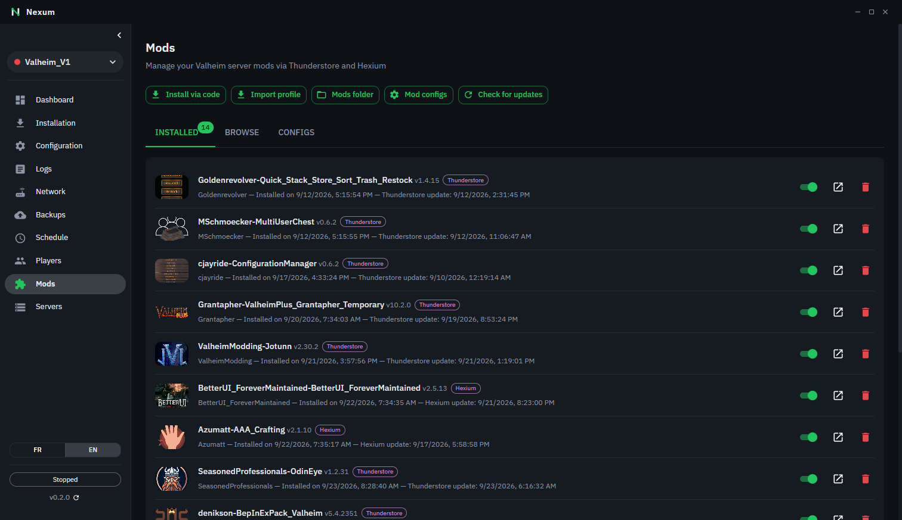

# Valheim mods

🇬🇧 English | 🇫🇷 [Français](valheim-mods.fr.md)

The **Mods** page of a Valheim server lets you install, update and configure BepInEx mods from two registries: [Thunderstore](https://thunderstore.io/c/valheim/) and [Hexium](https://valheim.hexium.gg/).

## BepInEx

Most Valheim mods require **BepInEx**. If Nexum doesn't find it in the server folder, a banner says so, with an **Install BepInEx** button.

> Mods are only loaded when the server starts: restart it after any install, uninstall, or enable/disable.

## Server and players

Nexum installs mods **on the server only**. Most mods must **also be installed by each player**, with a client mod manager such as [Gale](https://github.com/Kesomannen/gale), r2modman or the [Hexium mod manager](https://hexium.gg/mod-manager). The mod's page on its registry says whether it's needed on the client, on the server, or both. A mod installed on the server only will usually seem to do nothing.

Tip: build your modpack in Gale, export the profile code, and import it in Nexum (see below) so the server and players get the same mods.

## Installed tab

Lists the mods in `BepInEx/plugins/`, each with:

- a badge showing its source: **Thunderstore** (blue), **Hexium** (purple), or **Manual** (grey) for a mod copied by hand outside Nexum;
- an **Enabled / Disabled** switch (a disabled mod is actually moved out of `plugins/`);
- **Uninstall**, and a link to the mod's page on its registry.

The line under the name shows when the mod was installed and when the installed version was published on its registry ("Version published on Thunderstore: …").

The **search bar** at the top filters the list by mod name or author, with the number of mods shown next to it. Spaces, dashes and case are ignored: `azu auto` finds `Azumatt-AzuAutoStore`.

The **Sort by** menu next to it changes the order of the list: name (default), updates available first (then deprecated mods), recently installed, recently updated (installed version published most recently) or author. Your choice is remembered.

### Updates

**Check for updates** compares each mod with the latest published version. A "vX.Y available" badge appears when an update exists, and **Update all** installs them in one go.

Each installed mod is checked directly with its registry, so an update published a few minutes ago already shows up. The **Browse** tab, on the other hand, uses the registry's full mod list, which can lag up to about an hour behind: a brand-new version may only appear there later. Install the mod, then use **Check for updates**.

> **Players get kicked with "version mismatch" or "mod not installed"?** Mods that check versions (Jötunn and the mods built on it, ServerSync…) require the **exact same versions** on the server and on each player's game. Update the server's mods, then give your players a fresh **Share modpack** code so they get the same versions.

Nexum also checks automatically **every time the server starts**: if active mods have an update or were deprecated, it's written in the server log and a notification offers to open the Mods page. Update mods while the server is stopped.

Before **Update** or **Update all**, Nexum backs up the world (a single backup for the whole batch), unless the option is turned off on the Backups page: see [Backups](backups.md#backup-before-every-update). If a mod update breaks the world, restore that backup and reinstall the older version of the mod.

If the new version is on the **other** registry (e.g. an author who moved from Thunderstore to Hexium), the badge says so ("available on Hexium") and the button spells out the source change before installing.

### Deprecated mods

A red **Deprecated** badge flags a mod its author marked as deprecated on its registry: it is no longer maintained and may break after a game update. Hover the badge for details — if a maintained version exists on the other registry, the tooltip says so and you just need to apply the suggested update.

Manually installed mods are not covered: without a known registry, Nexum can check neither their status nor their updates.

## Browse tab

- Pick the registry (**Thunderstore** or **Hexium**): the two lists are independent.
- **Trending**, **New**, **Updated** tabs, or free search. Search results are sorted by relevance: exact name first, then names starting with or containing your search, then author and description matches (spaces and dashes are ignored, so `azu auto` finds AzuAutoStore). Deprecated mods only show up in search results, with the **Deprecated** badge, after maintained mods that match just as well.
- Each mod shows the date of its **last update** next to the author. It turns **orange** with a ⚠ when the mod hasn't been updated in over a year: it may not work with the current version of Valheim, so check the comments on its page before installing. (A registry page may also show the date the mod was _first_ uploaded; Nexum shows the latest update.)
- Install the latest version in one click, or pick a specific one via **Versions**.
- If the mod has dependencies that aren't installed, Nexum offers to install them (**Install all**), including when they come from the other registry.

### Install via code or profile

- **Install via code**: paste an `Author-ModName-Version` code and pick its registry (the same code can exist on both).
- **Import profile**: paste a profile code exported from r2modman, Gale, Thunderstore or Hexium, or import a `.r2z` file. Profiles mixing Thunderstore and Hexium mods are supported.

### Share the modpack with your players

**Share modpack** creates a profile code with all the **active** mods of the server (plus BepInEx). Give it to your players: in **Gale** or **r2modman**, import a profile from a code and paste it. They get exactly the same mods and versions as the server.

- If the server uses **Hexium** mods, players need **Gale** (or the Hexium mod manager): r2modman only knows Thunderstore.
- Mods installed by hand (outside Nexum) have no registry code and aren't included: players must install them themselves.
- The code is stored by Thunderstore (this is how r2modman and Gale share profiles) and may expire after a while: just create a new one.
- Only the list of mods and versions is sent, with the server name as the profile name. No config file, world or personal data.

## Configs tab

Lists the `.cfg` files generated by mods in `BepInEx/config/` (a mod creates its file the first time the server starts).

- Filter the list by file name, then click **Edit**.
- The editor shows each setting with the right kind of field (checkbox, dropdown, bounded number…) based on the comments BepInEx generates, along with its default value.
- The search field filters settings by name, description or section.
- Only the changed value lines are rewritten: the rest of the file (comments, order) is kept.
- If you close a modified file without saving, Nexum asks for confirmation: **Keep editing**, **Discard changes** or **Save**.

> As with mods, config changes only apply after a server restart.
